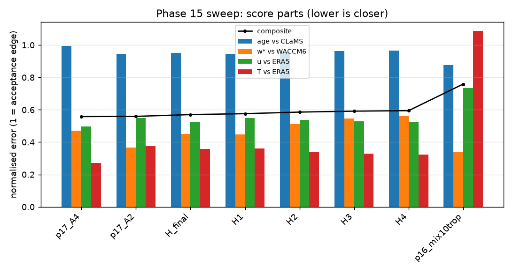
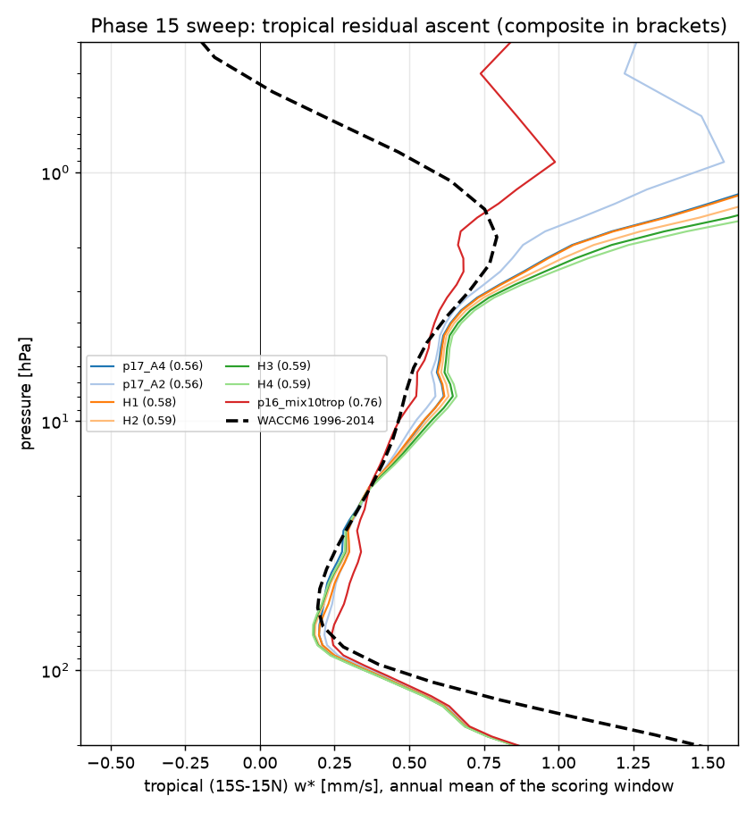
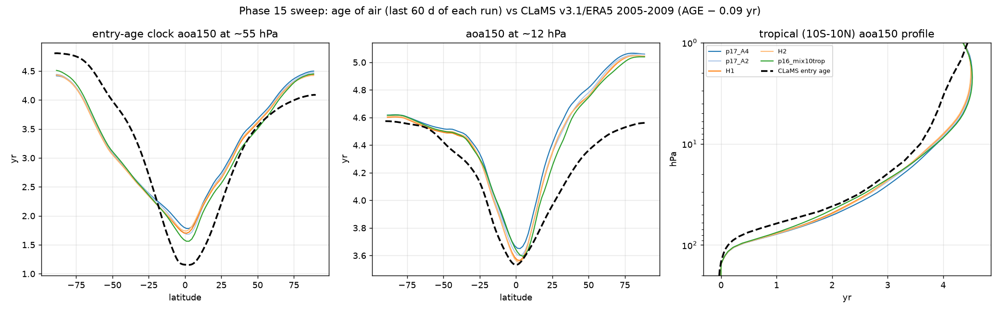

# Phase 18 — T_e correction with ERA5's diabatic heating as the tropical target (strat81, GPU 0)

Status: **running unattended** (tmux `strat_p18`, log `runs/p18.log`, branch `phase18-heating` in the main `jcm-strat` checkout).
Susanne, 2026-10-01: "I need age of air to look like that of CLaMS, and the tropical upwelling needs to match ERA5 better too" ...
"can you set this up what you just laid out and run it? Use GPU 0". Nothing is pushed by the pipeline.

## Why

Phase 17 fitted the JFV equilibrium temperature to ERA5's temperature everywhere: T RMSE 5.4 → 1.3 K, u 3.7 → 2.5 m/s, but the
age got older (0.44 → 0.51 yr), the subtropical barrier leakier and w* moved away from ERA5. The model's own Newtonian heating
(T_e − T)/τ against ERA5's total diabatic heating (`THETA_DOT_TOT` of the CLaMS v3 ERA5 reanalysis files, 2000–2014 climatology,
as a temperature tendency θ̇ (p/1000)^κ; its units attribute is a placeholder, the values are K/day) shows why — annual means,
K/day, at 0 / 15 / 25 / 35°:

| p | Phase 16 `mix10trop` (start) | ERA5 | Phase 17 `A4` |
|---|---|---|---|
| 100 hPa | 0.39 / 0.42 / 0.41 / 0.25 | 0.41 / 0.40 / 0.32 / 0.11 | 0.40 / 0.43 / 0.43 / 0.27 |
| 70 hPa | 0.31 / 0.35 / 0.27 / 0.11 | 0.15 / 0.36 / 0.33 / 0.10 | 0.13 / 0.15 / 0.06 / −0.02 |
| 50 hPa | 0.34 / 0.31 / 0.20 / 0.10 | 0.19 / 0.21 / 0.17 / 0.01 | 0.23 / 0.25 / 0.18 / 0.09 |
| 30 hPa | 0.30 / 0.25 / 0.11 / 0.05 | 0.27 / 0.21 / 0.10 / −0.06 | 0.27 / 0.25 / 0.14 / 0.06 |
| 10 hPa | 0.43 / 0.24 / −0.01 / −0.19 | 0.65 / 0.49 / 0.29 / 0.03 | 0.70 / 0.42 / 0.12 / −0.10 |

The start state heats too much at the equator at 70–50 hPa and too far poleward at 100 hPa (the upward mass flux at 70 hPa is
+19 % annual, +42 % in JJA against ERA5 while the 15S–15N w* matches: the upwelling region is too wide). Phase 17's temperature
target cut the 70 hPa heating at 15–25° to less than half of ERA5's — the weaker shallow branch and the older ages. In the
tropics the cross-isentropic transport is the diabatic heating itself (CLaMS uses θ̇ as its vertical velocity), so the target
there should be ERA5's heating, not its temperature.

## Method

* `scripts/teq_correction.py --heating-target`: inside the mask (|lat| ≤ 30° and p ≥ 30 hPa full weight, cos² tapers to zero at
  40° and 15 hPa) the update is dT_e −= α τ (Q_model − Q_ERA5), with Q_model = (T_e − T)/τ from the run's monthly-mean T and the
  T_e it used; outside, Phase 17's dT_e −= α (T_model − T_ERA5). α = 0.7, the same smoothing, cap and 100 hPa / 1 hPa handling.
* H1 = Phase 17's converged `A4` outside the mask (its temperature and wind gains) plus the first heating step inside, computed
  from `mix10trop` itself; H2…H4 iterate from their own runs. Each iteration runs 1998–1999 from `mix10trop`'s 1997 state (with
  the Rayleigh drag, as `mix10trop` and `A4`); the best-scoring correction then runs ten years 1990–1999 from ERA5 (`H_final`).
* Score: `sweep_score.py --w-metric full` — the w* term is now the mean |ln ratio| against ERA5 over annual, DJF and JJA w* at
  100/70/50/30/10 hPa AND the upward mass flux at 100/70/30/10 hPa (the width of the upwelling region), with age vs CLaMS, u
  and T vs ERA5 as before. The references `p16_mix10trop`, `p17_A2`, `p17_A4` are re-scored with the same metric.

## Leaderboard

<!-- leaderboard:start -->
8 scored run(s) as of 2026-10-02 01:09 PDT. Composite = mean(age RMSE/0.5 yr, w* log-error/ln 1.5, u RMSE/5 m/s, T RMSE/5 K); lower is closer; the age term is the entry-age clock against CLaMS (AGE minus CLaMS' own 0.09 yr at 150 hPa), w* against WACCM6, u and T against ERA5 (same months).

**Best so far: `p17_A4`** — Phase 17 A4 - T_e toward ERA5 T, 4 iterations (the outer correction of Phase 18): composite 0.558 (base 0.759); age RMSE 0.50 (base 0.44) yr, bias +0.20 (base +0.12); tropical w* 100/70/50/30/10 hPa 0.33/0.20/0.22/0.28/0.55 (base 0.35/0.24/0.29/0.33/0.47, WACCM6 0.40/0.21/0.20/0.26/0.47); u RMSE 2.5 (base 3.7) m/s, T RMSE 1.4 (base 5.4) K; `aoa150` 55 hPa tropics 1.87 (base 1.68) / 50-70 3.72 (base 3.68), 12 hPa tropics 3.72 (base 3.69) yr; cost 34 (base 34) min/yr.

Closer than the base (0.759): p17_A4, p17_A2, H_final, H1, H2, H3, H4. Further from it: none.

| rank | run | stage | composite | age RMSE `aoa150` vs CLaMS-entry [yr] | age bias | w* log-err | u RMSE [m/s] | T RMSE [K] | w* 100/70/50/30/10 hPa [mm/s] | `aoa150` 55 hPa trop / 50-70 | `aoa150` 12 hPa trop / 50-70 | `aoa_sfc` RMSE vs CLaMS | `aoa_sfc` 55 hPa trop (CLaMS 1.33) | `aoa500` 100 hPa trop [yr] (500->100 transit) | w* 1 hPa trop / NH / SH | w* ref | ERA5 w* 100/70/50/30/10 | barrier age 55 hPa (25-35 minus 0-10) | min/yr | what |
|---|---|---|---|---|---|---|---|---|---|---|---|---|---|---|---|---|---|---|---|---|
| 1 | **p17_A4** | ref | 0.558 | 0.50 | +0.20 | 0.19 | 2.5 | 1.4 | 0.33/0.20/0.22/0.28/0.55 | 1.87 / 3.72 | 3.72 / 4.73 | 1.33 | 3.06 | 1.10 | 2.03 / -1.77 / -2.16 | ERA5 full | 0.42/0.24/0.27/0.33/0.44 | 0.86 | 34 | Phase 17 A4 - T_e toward ERA5 T, 4 iterations (the outer correction of Phase 18) |
| 2 | p17_A2 | ref | 0.559 | 0.47 | +0.16 | 0.15 | 2.7 | 1.9 | 0.34/0.22/0.25/0.30/0.53 | 1.78 / 3.70 | 3.67 / 4.71 | 1.28 | 2.95 | 1.07 | 1.55 / -2.00 / -2.34 | ERA5 full | 0.42/0.24/0.27/0.33/0.44 | 0.92 | 34 | Phase 17 A2 - T_e toward ERA5 T, 2 iterations |
| 3 | H_final | H | 0.570 | 0.48 | +0.15 | 0.18 | 2.6 | 1.8 | 0.32/0.20/0.24/0.30/0.55 | 1.80 / 3.68 | 3.65 / 4.70 | 1.26 | 2.96 | 1.06 | 2.04 / -1.81 / -2.18 | ERA5 full | 0.42/0.24/0.27/0.33/0.44 | 0.87 | 36 | mix10trop + T_e correction: ERA5 heating target in the tropical lower stratosphere, ERA5 T elsewhere, correction H1, ten years 1990-1999 from ERA5 |
| 4 | H1 | H | 0.576 | 0.47 | +0.14 | 0.18 | 2.7 | 1.8 | 0.32/0.20/0.24/0.30/0.55 | 1.80 / 3.68 | 3.64 / 4.70 | 1.25 | 2.95 | 1.06 | 2.05 / -1.79 / -2.18 | ERA5 full | 0.42/0.24/0.27/0.33/0.44 | 0.87 | 36 | mix10trop + T_e correction: ERA5 heating target in the tropical lower stratosphere, ERA5 T elsewhere, iteration 1 (1998-1999 from mix10trop 1997) |
| 5 | H2 | H | 0.586 | 0.48 | +0.15 | 0.21 | 2.7 | 1.7 | 0.32/0.18/0.23/0.29/0.56 | 1.83 / 3.68 | 3.63 / 4.71 | 1.26 | 2.99 | 1.07 | 2.24 / -1.73 / -2.13 | ERA5 full | 0.42/0.24/0.27/0.33/0.44 | 0.85 | 36 | mix10trop + T_e correction: ERA5 heating target in the tropical lower stratosphere, ERA5 T elsewhere, iteration 2 (1998-1999 from mix10trop 1997) |
| 6 | H3 | H | 0.592 | 0.48 | +0.16 | 0.22 | 2.6 | 1.6 | 0.31/0.18/0.22/0.29/0.58 | 1.84 / 3.68 | 3.62 / 4.71 | 1.26 | 3.01 | 1.07 | 2.40 / -1.69 / -2.10 | ERA5 full | 0.42/0.24/0.27/0.33/0.44 | 0.85 | 36 | mix10trop + T_e correction: ERA5 heating target in the tropical lower stratosphere, ERA5 T elsewhere, iteration 3 (1998-1999 from mix10trop 1997) |
| 7 | H4 | H | 0.595 | 0.48 | +0.16 | 0.23 | 2.6 | 1.6 | 0.31/0.18/0.22/0.29/0.59 | 1.85 / 3.69 | 3.61 / 4.71 | 1.27 | 3.01 | 1.07 | 2.55 / -1.69 / -2.09 | ERA5 full | 0.42/0.24/0.27/0.33/0.44 | 0.85 | 36 | mix10trop + T_e correction: ERA5 heating target in the tropical lower stratosphere, ERA5 T elsewhere, iteration 4 (1998-1999 from mix10trop 1997) |
| 8 | p16_mix10trop | ref | 0.759 | 0.44 | +0.12 | 0.14 | 3.7 | 5.4 | 0.35/0.24/0.29/0.33/0.47 | 1.68 / 3.68 | 3.69 / 4.69 | 1.21 | 2.82 | 1.03 | 0.99 / -2.26 / -2.57 | ERA5 full | 0.42/0.24/0.27/0.33/0.44 | 0.95 | 34 | Phase 16 mix10trop - the start state, no T_e correction |
| | *references* | | | CLaMS entry age (AGE − 0.09) | | WACCM6 | ERA5 | ERA5 | 0.40/0.21/0.20/0.26/0.47 | CLaMS 1.24 / 4.03 (WACCM entry 1.11 / 3.40) | CLaMS 3.59 / 4.47 (WACCM 2.82 / 4.18) | | | | full ECHAM 1994: +0.96 / −1.29 / −3.19 | | | CLaMS 1.57 | | |

<!-- leaderboard:end -->

## Results

_to be written when the run finishes_

## Run log
- 2026-10-01 11:34 PDT — started (GPU 0, commit 678dd06, 4 iterations, alpha 0.7)
- 2026-10-01 13:07 PDT — **H1** (mix10trop + T_e correction: ERA5 heating target in the tropical lower stratosphere, ERA5 T elsewhere, iteration 1 (1998-1999 from mix10trop 1997)): [score H1] composite 0.576 = mean(age 0.95, w* 0.45, u 0.55, T 0.36); age150 RMSE vs CLaMS-entry 0.47 yr (bias +0.14); tropical w* 100/70/50/30/10: 0.32/0.20/0.24/0.30/0.55 (WACCM 0.40/0.21/0.20/0.26/0.47); barrier age 55 hPa 0.87 (CLaMS 1.57); u RMSE 2.7 m/s, T RMSE 1.8 K; 36 min/yr -> /data/JCM_stripped/jcm-strat/docs/outputs/18_heating/scores/H1.json
- 2026-10-01 14:45 PDT — **H2** (mix10trop + T_e correction: ERA5 heating target in the tropical lower stratosphere, ERA5 T elsewhere, iteration 2 (1998-1999 from mix10trop 1997)): [score H2] composite 0.586 = mean(age 0.96, w* 0.51, u 0.54, T 0.34); age150 RMSE vs CLaMS-entry 0.48 yr (bias +0.15); tropical w* 100/70/50/30/10: 0.32/0.18/0.23/0.29/0.56 (WACCM 0.40/0.21/0.20/0.26/0.47); barrier age 55 hPa 0.85 (CLaMS 1.57); u RMSE 2.7 m/s, T RMSE 1.7 K; 36 min/yr -> /data/JCM_stripped/jcm-strat/docs/outputs/18_heating/scores/H2.json
- 2026-10-01 16:26 PDT — **H3** (mix10trop + T_e correction: ERA5 heating target in the tropical lower stratosphere, ERA5 T elsewhere, iteration 3 (1998-1999 from mix10trop 1997)): [score H3] composite 0.592 = mean(age 0.96, w* 0.55, u 0.53, T 0.33); age150 RMSE vs CLaMS-entry 0.48 yr (bias +0.16); tropical w* 100/70/50/30/10: 0.31/0.18/0.22/0.29/0.58 (WACCM 0.40/0.21/0.20/0.26/0.47); barrier age 55 hPa 0.85 (CLaMS 1.57); u RMSE 2.6 m/s, T RMSE 1.6 K; 36 min/yr -> /data/JCM_stripped/jcm-strat/docs/outputs/18_heating/scores/H3.json
- 2026-10-01 18:03 PDT — **H4** (mix10trop + T_e correction: ERA5 heating target in the tropical lower stratosphere, ERA5 T elsewhere, iteration 4 (1998-1999 from mix10trop 1997)): [score H4] composite 0.595 = mean(age 0.97, w* 0.56, u 0.52, T 0.32); age150 RMSE vs CLaMS-entry 0.48 yr (bias +0.16); tropical w* 100/70/50/30/10: 0.31/0.18/0.22/0.29/0.59 (WACCM 0.40/0.21/0.20/0.26/0.47); barrier age 55 hPa 0.85 (CLaMS 1.57); u RMSE 2.6 m/s, T RMSE 1.6 K; 36 min/yr -> /data/JCM_stripped/jcm-strat/docs/outputs/18_heating/scores/H4.json
- 2026-10-01 18:03 PDT — best iteration H1 (composite 0.575929472581503) -> ten years from ERA5
- 2026-10-02 00:10 PDT — **H_final** (mix10trop + T_e correction: ERA5 heating target in the tropical lower stratosphere, ERA5 T elsewhere, correction H1, ten years 1990-1999 from ERA5): [score H_final] composite 0.570 = mean(age 0.95, w* 0.45, u 0.52, T 0.36); age150 RMSE vs CLaMS-entry 0.48 yr (bias +0.15); tropical w* 100/70/50/30/10: 0.32/0.20/0.24/0.30/0.55 (WACCM 0.40/0.21/0.20/0.26/0.47); barrier age 55 hPa 0.87 (CLaMS 1.57); u RMSE 2.6 m/s, T RMSE 1.8 K; 36 min/yr -> /data/JCM_stripped/jcm-strat/docs/outputs/18_heating/scores/H_final.json
- 2026-10-02 01:09 PDT — final diagnostics for H_final in `final/`
- 2026-10-02 01:09 PDT — finished
