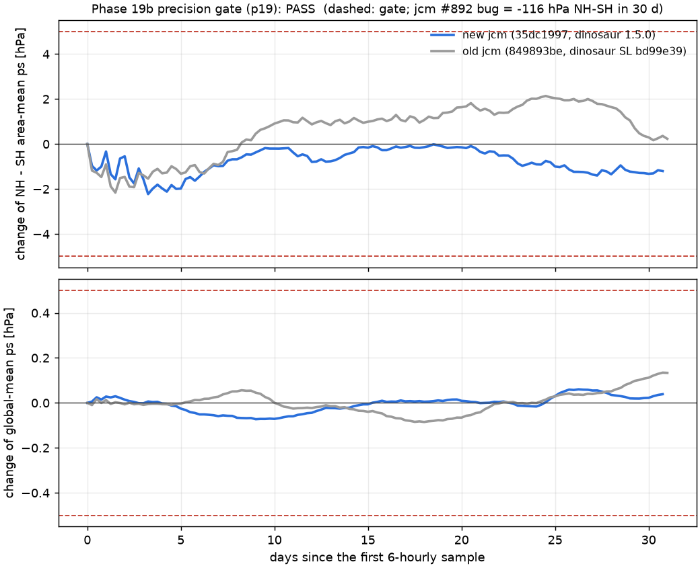
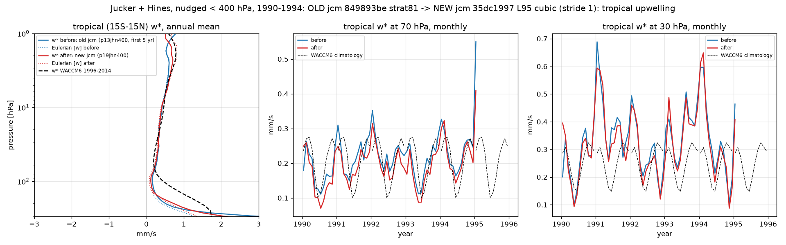
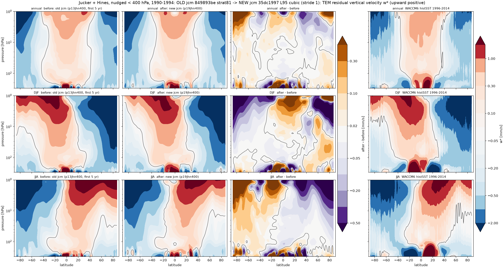
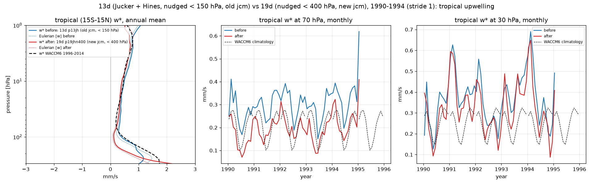
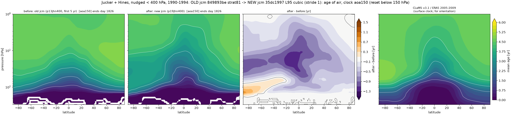
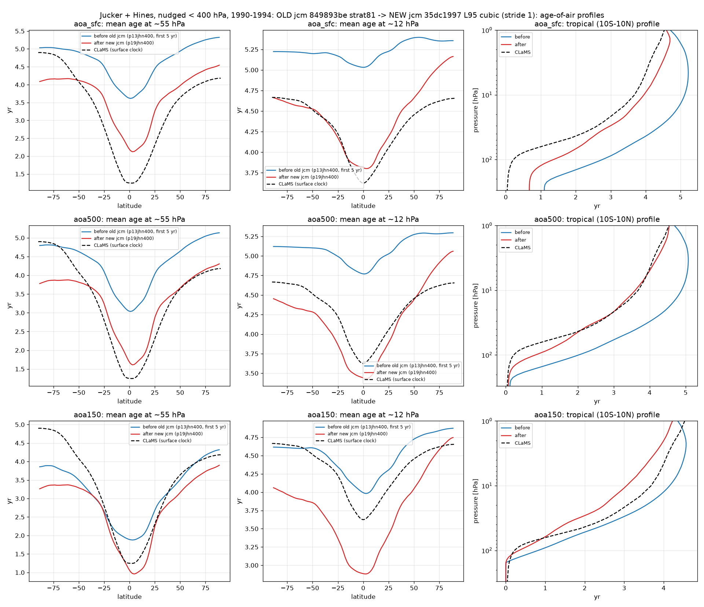
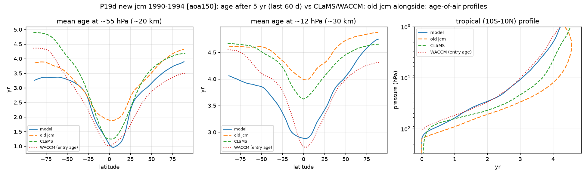
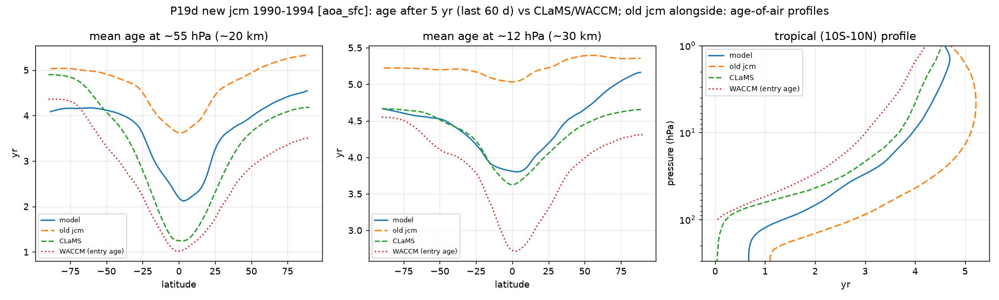
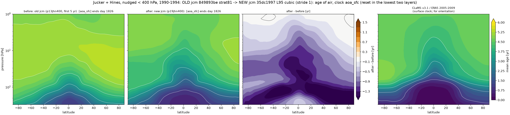
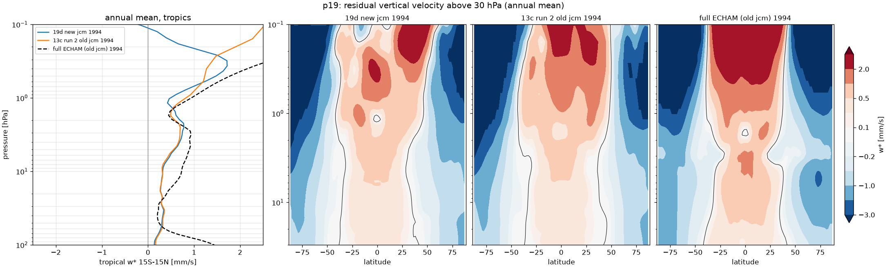

# Phase 19 — jcm update (PR #1027 fixes), precision check, 19d baseline (13d physics, nudged < 400 hPa, new jcm)

Status: **complete** (pipeline `scripts/phase19_run.sh`, tmux `strat_p19_run`, GPU 4; first launched 2026-10-07 12:02 PDT, relaunched
14:30 PDT after the cubic-interpolation blow-up, relaunched again 18:16 PDT on the **full T63L95 grid with cubic SL interpolation**
(Susanne, 18:30 PDT entry in decisions.md); chain 18:46–21:47 PDT, diagnostics to 22:48 PDT, write-up 22:48–22:55 PDT).

**Headline.** 19d (13d physics, nudging below 400 hPa, new jcm, **L95 + cubic**) against the old p13jhn400 (same physics, old jcm,
**strat81 + linear**), first 5 years each: the residual circulation is almost unchanged (tropical w* 100 / 70 / 50 / 30 / 10 hPa
0.157 → 0.117 / 0.214 → 0.191 / 0.290 → 0.273 / 0.330 → 0.320 / 0.419 → 0.411 mm/s, WACCM6 0.398 / 0.211 / 0.201 / 0.255 / 0.469;
the n400 shallow-branch deficit of Phase 13c is still there and a little worse), **but every age-of-air clock is 0.4–1.4 yr
younger**: entry age `aoa150` at 55 hPa tropics 1.92 → 1.14 yr (WACCM6 1.19), at 12 hPa 4.02 → 2.90 (2.90 ± 0.4), 50–70° 3.74 →
3.38 (≥ 3.6). Younger air with slightly *weaker* upwelling means the change is in transport/mixing, not in the residual
circulation. Because 19d changes the jcm version **and** the grid (strat81 → L95: 8 → 22 layers above 1.08 hPa; identical
levels below) **and** the SL vertical interpolation (linear → cubic) at once, this run cannot attribute the age change to any
one of them (see "What changed and why").
Sections 19a-19c and the precision gate are written by the set-up session; the 19d Results are filled in by the
pipeline's write-up agent. Every decision with its options: [decisions.md](decisions.md).

## Why

A colleague found that jax-gcm PR #1027 (merged 2026-10-05, 1d444197) fixed Lott-Miller SSO (`nktopg=1` made the
"low-level" state a whole-column mean; drag ~100x too strong), removed its land-fraction factor, and replaced the upper
sponge (10 levels, full wind, T relaxed to `target_T_K` 250 K) with ECHAM's `uspnge` (top level, 3 h, m != 0 only). Our
pin 849893be had all of it; Phases 12 run 4, 13 (GWD) and 14 used the broken Lott-Miller. Updating jcm drags in
dinosaur >= 1.5.0, whose bf16 GPU dots are miscompiled by our jaxlib 0.10.2 (NH -> SH mass drift) unless jcm #892's
override is active. Phase 19 updates jcm, checks the precision explicitly, ports jcm-strat, and reruns the 13d physics
with nudging below 400 hPa (= Phase 13c run 2 on the old jcm) to measure the update's effect alone (19d).

## 19a — environment

| item | old (Phases 1-18) | new (Phase 19) |
|---|---|---|
| jax-gcm | 849893be (2.1.0b0) | **35dc1997** (origin/dev 2026-10-06, 3.0.0rc1; contains 1d444197 #1027 and 4dbe734d #892) |
| dinosaur | shoyer/dinosaur@semi-lagrangian bd99e39 (git submodule, 1.4.0) | **1.5.0 from PyPI**, exact pin `dinosaur==1.5.0` forced through `env/overrides.txt` (submodule removed) |
| jax / jaxlib | 0.10.2 | 0.10.2 (pinned; jcm caps < 0.11) |
| venv | main checkout `.venv` (shared by the old worktrees) | own `.venv` in `/data/JCM_stripped/jcm-strat-phase19` |

`scripts/bootstrap_env.sh` and `scripts/check_env.sh` updated; check_env: all PASS on GPU (2026-10-07 11:05 PDT).

## 19b — precision check (jcm #892)

1. **Where the algorithms live** (`grep -n DOT_ALGORITHM` in the installed dinosaur 1.5.0, [p19b_grep_dot_algorithm.txt](p19b_grep_dot_algorithm.txt)):
   `jax_numpy_utils.py:36 FLOAT32_DOT_ALGORITHM = lax.DotAlgorithmPreset.BF16_BF16_F32_X6`, used at `:120`;
   `spherical_harmonic.py:47 FAST_TRANSFORM_DOT_ALGORITHM = jax.lax.DotAlgorithmPreset.BF16_BF16_F32_X3`, used at `:429`.
2. **In our entry point**: `jcm_strat/main.py` imports `jcm.main` (and with it `jcm.dycore.dinosaur`, which applies the
   override) before any jcm_strat term, calls `apply_dot_precision_workaround()` once more (idempotent), and prints both
   values before the model build and again after `jcm.runners.build_model` returns; it refuses to run if either is not
   `Precision.HIGHEST` on an affected jaxlib. Every log of Phases 19-21 carries, twice:
   `jcm_strat: dinosaur dot precision FLOAT32_DOT_ALGORITHM=HIGHEST FAST_TRANSFORM_DOT_ALGORITHM=HIGHEST (jaxlib 0.10.2, affected by the bf16 miscompile: True)`.
3. **jcm's `dot_precision_test.py` on GPU 0**: 7 passed, including the GPU-only single-level inverse-transform regression
   test ([p19b_dot_precision_test.log](p19b_dot_precision_test.log)).
4. **30-day gate** on the 19d spin-up month (1989-12-01 + 31 d, the 19d configuration exactly): change of the NH-SH
   area-mean surface pressure and of the global mean from the first 6-hourly sample. **PASS**: max |dNH-SH| 2.00 hPa
   (end -0.96), max |dglobal| 0.08 hPa (end +0.04) (final, linear-SL spin-up; the first, cubic spin-up gave 2.17 / 0.07);
   the old jcm with the same physics (January 1990) swings by 2.16 / 0.13 hPa. The bug's signature is -116 hPa in 30 days. Details: [p19_ps_gate.md](p19_ps_gate.md).

   **Final gate (the one that stands, L95 + cubic spin-up `runs/p19jhn400_spinup_19891201`, 2026-10-07 18:46 PDT): PASS**,
   max |dNH-SH| **2.228 hPa** (end −1.204), max |dglobal| **0.0726 hPa** (end +0.0386); old jcm 2.162 / 0.1345 hPa. The three
   gates (strat81 cubic 2.17 / 0.07, strat81 linear 2.00 / 0.08, L95 cubic 2.23 / 0.07) agree: natural NH-SH exchange, no drift.

   | run | NH-SH at start [hPa] | max abs dNH-SH | dNH-SH at end | global mean at start | max abs dglobal | dglobal at end |
   |---|---|---|---|---|---|---|
   | new jcm (35dc1997, dinosaur 1.5.0), L95 cubic, Dec 1989 | −4.80 | 2.228 | −1.204 | 998.52 | 0.0726 | +0.0386 |
   | old jcm (849893be, dinosaur SL bd99e39), strat81, Jan 1990 | −5.15 | 2.162 | +0.229 | 998.51 | 0.1345 | +0.1335 |

   Item 2 in the 19d production log (`runs/p19jhn400_19900101/log.txt`): line 6 (before the build)
   `jcm_strat: dinosaur dot precision FLOAT32_DOT_ALGORITHM=HIGHEST FAST_TRANSFORM_DOT_ALGORITHM=HIGHEST (jaxlib 0.10.2, affected by the bf16 miscompile: True)`
   and the identical line 178 after `build_model` returned (just before the provenance line `jcm=35dc1997 ... 1xNVIDIA H200`);
   same in all five segments and the spin-up. Item 1 grep output: [p19b_grep_dot_algorithm.txt](p19b_grep_dot_algorithm.txt)
   (4 hits, as listed above).

   

## 19c — port to jcm 3

pytest 99 passed after the port (82/89 passed before it). What broke and how it was fixed (details and options in
decisions.md):

- `run.start_date` -> `run.start_time` — **silent** in jcm 3 (an unknown key; the run would have started on 2000-01-01).
  `jcm_strat.main` now refuses `run.start_date` and `run.sponge.target_T_K`.
- One Gregorian clock in jcm 3; `calendar: gregorian` is kept as a checked key (anything else refused).
- `run=longrun` writes calendar-month means only; the base experiments set `monthly_means: false, save_chunks: true` so
  the 6-hourly `longrun_day<N>.nc` chunks every diagnostic reads are written as before.
- Sponge: jcm 3's `UpperSponge` is ECHAM's `uspnge`; all experiments use `run.sponge.levels: 1` with ECHAM's 3 h and
  enspodi 1; the old remapped strat63/strat81 sponge (4 levels, enspodi 6.73, full wind, T -> 250 K) is gone.
  SL vertical interpolation: jcm 3's default is cubic (was linear). **With cubic the dry strat81 runs blow up** in the
  upper mesosphere (0.09-0.4 hPa: |u| 190-230 m/s, T collapsing, NaN) after 10-230 days of every year, and jcm's
  health stop exits 0, so the first 19d/20 chains silently spliced partial years (found 13:27 PDT; all that output is
  quarantined in runs/invalid_cubic_20261007/). Test runs of 1990 from the spin-up checkpoint: the old 4-level sponge
  geometry still blew up (day 130); **linear interpolation ran the whole year healthy**. 19d and 20 therefore use
  `dycore.sl_vertical_interpolation: linear`; the full-physics runs (21) keep jcm's cubic. chain_segments.sh now treats
  a health stop as a failed segment. Both settings are echoed in every run header.
  **Superseded 18:30 PDT (Susanne):** 19d and 20 run on the full T63L95 grid with jcm's cubic interpolation instead
  (`override /grid: echam_t63_l95_hybrid`, `level_table: null`, `dycore.sl_vertical_interpolation: null`; commit ca392cf),
  after the test `runs/p19t_l95cubic` (19d config, L95, cubic, 1990) ran healthy: the blow-up needs cubic AND strat81's 8 thick
  mesospheric layers. The final 19d had no health stop in any segment. The strat81 + linear chains (19d 1990–1994 complete,
  20 partial) are kept in `runs/superseded_strat81_linear_20261007/` — valid runs, not analysed here.
- `forcing.ozone_file: auto` now fails for the strat tables (no on-grid bundle); `analytic`, what jcm 2 used silently.
- jcm 3's ECHAM package gained `echam_surface_exchange`; added to our full-physics term lists (Phase 21).
- Unchanged: the tracer mass-fixer policy wrapper, Hines/Lott-Miller import paths, the L95 table (so the ERA5 window
  hashes and the cached 1990-1999 windows are reused), `jcm.data.era5`.
- Also new in jcm 3 and part of "the update's effect": dinosaur 1.5's hybrid-coordinate temperature equation, virtual
  temperature in the hybrid dynamics (the dry runs carry ERA5's initial humidity passively), a mass fixer on specific
  humidity, the nodal-tracer fixer factor clipped to [2/3, 1.5].

**Spin-up** (Susanne's request): every chain starts 1989-12-01 from ERA5 and runs 31 days (`runs/<prefix>_spinup_19891201`,
QBO target year 1989, not linked into the aggregate, so excluded from every diagnostic); the 1990 segment starts from its
checkpoint with `first_segment=true`, which now also restarts the clocks, sources and `sai` at 0 on the first step (the
identity without a spin-up). Verified: smoke restart and the real 1990 segments read 0.250 d on the clocks at 06 UTC
1 January. Smokes (5 d) of all four Phase 19-21 configurations passed on 2026-10-07.

## What was run (19d)

| item | value |
|---|---|
| pipeline | `scripts/phase19_run.sh` in tmux `strat_p19_run`, log `runs/p19_run.log`; start 2026-10-07 18:16 PDT, commit **ca392cf** (`RELAUNCHED=0`) |
| GPU | **4** (1× NVIDIA H200, per jcm's provenance line); GPU 0 held by another job, see decisions 11:57 PDT |
| experiment | `p19_jh_n400` = 13d physics (`strat_jucker_hines_prod13`: JFV2013 relaxation + Hines launched at 634 hPa, no Lott-Miller), ERA5 nudging of u, v, T only where p > 400 hPa, QBO nudging, 1 hPa clock lid; **T63L95 hybrid, cubic SL vertical interpolation**, ECHAM sponge `levels: 1`, dt 12 min, 6-hourly output |
| environment | jcm **35dc1997** (3.0.0rc1), dinosaur **1.5.0** (PyPI, exact pin), jax/jaxlib 0.10.2 — the run provenance line reads `jcm=35dc1997, dinosaur=ca392cff+dirty`: dinosaur is no longer a git checkout, so jcm's provenance falls back to the jcm-strat SHA; the version is the pinned 1.5.0 |
| pytest | `JAX_PLATFORMS=cpu python -m pytest tests -q -p no:cacheprovider` → 100 passed (18:21 PDT) |
| smokes | `smoke p19_jh_n400 p19_smoke5 4 physics.terms.held_suarez.qbo.year=1990`, then the restart smoke from its checkpoint (`init=from_state init.file=runs/p19_smoke5/checkpoint.ckpt`) → both PASS (18:35 PDT) |
| spin-up | `SPINUP="1989-12-01 31" SPINUP_ONLY=1 EXPERIMENT=p19_jh_n400 PREFIX=p19jhn400 SCHEME=calendar YEARS=1990-1994 AGG=p19jhn400_5yr SAVE_INTERVAL=0.25 GPU=4 bash scripts/chain_segments.sh` → `runs/p19jhn400_spinup_19891201` (18:35–18:46 PDT) |
| 19b gate | `python scripts/p19_ps_gate.py runs/p19jhn400_spinup_19891201 --ref <phase13>/runs/p13jhn400_19900101 --days 31 --out docs/outputs/19_jcm_update --tag p19` → PASS 18:46 PDT |
| chain | the same `chain_segments.sh` call without `SPINUP_ONLY` → segments `p19jhn400_19900101` … `_19940101`, 1990 with `physics.terms.production_tracers.first_segment=true`, per segment `physics.terms.held_suarez.qbo.year={year}`; aggregate `runs/p19jhn400_5yr` (187 files). 18:47–21:47 PDT, **all five segments exit 0, no health stop** |
| reference | `runs/old_p13jhn400_5yr` = symlinks to the first 1826 days of `jcm-strat-phase13/runs/p13jhn400_10yr` (Phase 13c run 2, old jcm, strat81, linear) |
| diagnostics (CPU, stride 1) | `python scripts/phase12_compare.py --before runs/old_p13jhn400_5yr --after runs/p19jhn400_5yr --tag update --stride 1` and `--before <phase13>/runs/p13jh_5yr ... --tag vs13d`; `scripts/aoa_vs_clams.py runs/p19jhn400_5yr ... --years 2005-2009 --last-saves 240 --var {aoa150,aoa500,aoa_sfc} --second-run runs/old_p13jhn400_5yr`; `scripts/mesosphere_wstar.py` on the 1994 segments of 19d, 13c run 2 and full ECHAM (stride 1); `scripts/sweep_score.py` on both 5-yr aggregates (22:27–22:48 PDT) |
| wall-clock | pipeline 4 h 32 min (18:16–22:48 PDT); chain incl. spin-up 3 h 12 min; **35–36 min per simulated year end-to-end** (1990: 41 min incl. compile) |
| throughput | 1738–1760 simulated d/h stepping (17 ms/step), 580–713 d/h end-to-end ([throughput_p19.csv](throughput_p19.csv)); old p13jhn400 on strat81: 2460–2510 d/h, ~600 e2e, ~36 min/yr — L95 costs 30 % more per step, the same per year end-to-end |

## 19d — Results

Old jcm (`p13jhn400`, first 5 yr, strat81 + linear) → new jcm (`p19jhn400_5yr`, **L95 + cubic**), the same physics and nudging.
For context the 13d run (`p13jh_5yr`: same physics nudged below 150 hPa, old jcm, strat81) → 19d (`vs13d_*`). All TEM at stride 1
(every 6-hourly frame), 1990–1994 annual means; ages = last 60 days (240 frames) of the 5-year chain; WACCM6 histSST 1996–2014,
CLaMS v3.1/ERA5 2005–2009. Tables: [update_metrics.md](update_metrics.md), [vs13d_metrics.md](vs13d_metrics.md),
[p19_mesosphere.md](p19_mesosphere.md), [scores/](scores/).

**What the comparison measures.** NOT the jcm update alone: 19d differs from p13jhn400 in (1) the jcm/dinosaur version (with
everything listed under 19c), (2) the grid — strat81 → full L95, i.e. 8 → 22 layers above 1.08 hPa (strat81 keeps every L95 level
between 1.08 hPa and the surface, `jcm_strat/levels.py`), and (3) the SL vertical interpolation, linear → cubic; plus (4) the
one-month spin-up from 1989-12-01 instead of a cold start on 1990-01-01, and (5) the new sponge (top level only, eddies only, no
T target vs 10 full-wind levels with T → 250 K). Any "effect" below is the effect of all five together.

### Acceptance-style summary (Phase 13 criteria; w* vs WACCM6 at stride 1; entry-age clock `aoa150` vs WACCM6)

| quantity | 13d `p13jh_5yr` (old jcm, n150, strat81) | old `p13jhn400` 5 yr (old jcm, n400, strat81) | **19d `p19jhn400_5yr`** (new jcm, n400, L95 cubic) | target |
|---|---|---|---|---|
| tropical w* 100 hPa [mm/s] | 0.352 | 0.157 | **0.117** | 0.398 |
| tropical w* 70 hPa | 0.296 | 0.214 | **0.191** | 0.211 |
| tropical w* 50 hPa | 0.341 | 0.290 | **0.273** | 0.201 |
| tropical w* 30 hPa | 0.369 | 0.330 | **0.320** | 0.255 (within 1.5×) |
| tropical w* 10 hPa | 0.490 | 0.419 | **0.411** | 0.469 (within 1.5×) |
| upward mass flux 100 / 70 / 30 / 10 hPa [10⁹ kg/s] | 12.00 / 8.30 / 3.48 / 1.49 | 9.35 / 6.63 / 2.95 / 1.21 | **8.79 / 6.20 / 2.87 / 1.23** | 10.85 / 6.05 / 3.05 / 1.37 |
| tropical `aoa150` 55 hPa [yr] | 1.41 | 1.92 | **1.14** | 1.19 |
| tropical `aoa150` 12 hPa [yr] | 3.45 | 4.02 | **2.90** | 2.90 ± 0.4 |
| 50–70° `aoa150` 55 hPa [yr] | 3.47 | 3.74 | **3.38** | ≥ 3.6 |
| surface clock `aoa_sfc` 55 hPa tropics / 50–70° [yr] | 3.13 / 4.67 | 3.69 / 5.03 | **2.28 / 4.16** | CLaMS 1.33 / 4.12 |
| surface clock `aoa_sfc` 12 hPa tropics / 50–70° [yr] | 4.59 / 5.11 | 5.05 / 5.30 | **3.82 / 4.68** | CLaMS 3.68 / 4.56 |
| tropical w* 1 / 0.5 / 0.3 hPa, 1994 [mm/s] | — (stride 4 only: +0.04 / +0.46 / +1.98) | +0.92 / +1.20 / +1.48 | **+0.46 / +1.48 / +1.71** | upward (ECHAM +0.91 / +1.78 / +2.64, stride 1) |
| polar descent 0.5 hPa NH / SH, 1994 [mm/s] | — (stride 4: −3.51 / −5.54) | −2.56 / −4.81 | **−2.32 / −4.37** | ECHAM −3.36 / −4.85 |
| u / T RMSE vs ERA5, 1993–94 [m/s / K] | — | 6.29 / 6.28 | **6.81 / 6.11** | ≤ 5 / ≤ 5 ("acceptable") |
| sweep composite (lower = better) | — | 1.124 | **1.200** | 1.0 = acceptable |
| cost [min/yr e2e] | 30–32 | 36 | **35–36** | ≤ 35 |

Met by 19d: 70 hPa w*, 30 and 10 hPa w* (within 1.5×), entry age 55 hPa tropics (1.14 vs 1.19) and 12 hPa tropics (2.90, on
target), mesospheric ascent and polar descent. Missed: **100 hPa w* (0.117 vs 0.398, 29 % of WACCM6 — the n400 shallow-branch
deficit of Phase 13c, slightly worse)**, 50 hPa w* (+36 %, as in every dry run), 50–70° entry age (3.38 vs ≥ 3.6), and the
u RMSE. Note: getting the ages right with a quarter of WACCM6's 100 hPa upwelling is not a success of the circulation — see below.

### Residual circulation: almost unchanged

Annual tropical (15S–15N) w* drops by 0.01–0.04 mm/s at every level from 100 to 10 hPa (100 hPa −25 %, 70 hPa −11 %, 50–10 hPa
−2 to −6 %); the annual upward mass flux by 6 % at 100 / 70 hPa and not at all at 30 / 10 hPa (−3 % / +2 %). Seasonally the
same picture: the largest drop is the JJA 100 hPa value (0.126 → 0.074, WACCM6 0.276); the DJF 10 hPa value rises slightly
(0.591 → 0.637, WACCM6 0.644). The monthly 70 and 30 hPa series (right panels) track each other month by month — the seasonal
cycle and the QBO-nudged interannual variability are the same in both runs. The vertical profile below 100 hPa is unchanged
and the 400 hPa cutoff's signature (w* collapsing between 150 and 100 hPa, WACCM6's 100 hPa peak missing) is fully present.
Against 13d (`vs13d_wstar*.png`) the n400 cutoff dominates: 100 hPa 0.352 → 0.117, 100 hPa mass flux 12.0 → 8.8.

### Age of air: 0.4–1.4 yr younger everywhere

| clock | 55 hPa tropics | 55 hPa 50–70° | 12 hPa tropics | 12 hPa 50–70° |
|---|---|---|---|---|
| `aoa150` (reset < 150 hPa) old → new | 1.92 → **1.14** (−0.78) | 3.74 → **3.38** (−0.36) | 4.02 → **2.90** (−1.12) | 4.69 → **4.08** (−0.62) |
| `aoa500` (reset < 500 hPa) | 3.12 → **1.79** (−1.33) | 4.77 → **3.87** (−0.90) | 4.79 → **3.45** (−1.34) | 5.20 → **4.47** (−0.73) |
| `aoa_sfc` (surface clock) | 3.69 → **2.28** (−1.40) | 5.03 → **4.16** (−0.86) | 5.05 → **3.82** (−1.23) | 5.30 → **4.68** (−0.62) |
| reference | WACCM6 entry 1.19, CLaMS 1.33 | ≥ 3.6, CLaMS 4.12 | 2.90 ± 0.4, CLaMS 3.68 | CLaMS 4.56 |

The ageing in every 13c/13d record (entry age at 55 hPa tropics 1.9–2.3 yr with n400 on the old jcm) is gone: the new run's
tropical lower stratosphere is as young as WACCM6, the tropical 12 hPa entry age sits on the WACCM6 value, and the surface
clock at 12 hPa is within 0.15 yr of CLaMS in the tropics and 0.12 yr in the extratropics (it was 1.4 / 0.7 yr too old). The
difference map (above, third panel) is largest in the tropical middle stratosphere (−1.3 yr at 10–30 hPa); it is small and of
the opposite sign (up to +0.3 yr) only in the SH high-latitude lowermost stratosphere below 100 hPa. The latitudinal age
contrast between tropics and 50–70° grows: at 55 hPa the `aoa150` "barrier" (50–70° minus tropics) is 0.96 → 1.56 yr (CLaMS
1.57), at 12 hPa 0.38 → 0.63 (CLaMS 0.54); the 1.5–3 hPa latitude standard deviation of `aoa150` triples (0.07 / 0.09 →
0.25 / 0.17 yr). So the new run has a **better-isolated tropical pipe and less in-mixing of old extratropical air** — with the
same or slightly weaker upwelling. In the sweep score the `aoa150` bias vs CLaMS (shifted) flips from +0.27 to −0.28 yr and the
RMSE is 0.53 → 0.58 yr: overall too young now where it was too old, on the CLaMS shape. The surface clock RMSE vs CLaMS falls
from 1.85 to 0.86 yr.

Caveat (as for every 5-yr record): the clocks are not converged at 5 yr where air is old (13d: the tropical 55 hPa entry age
rose 1.41 → 1.62 from year 5 to 10). The **1.14 yr is a 5-year number** and will likely rise in a 10-year chain.

### Mesosphere (1994, stride 1)

| run | tropics 1 / 0.5 / 0.3 hPa | NH cap 1 / 0.5 / 0.3 | SH cap 1 / 0.5 / 0.3 |
|---|---|---|---|
| 19d new jcm (L95) | +0.46 / +1.48 / +1.71 | −1.79 / −2.32 / −2.90 | −2.83 / −4.37 / −5.71 |
| 13c run 2 old jcm (strat81) | +0.92 / +1.20 / +1.48 | −2.30 / −2.56 / −2.85 | −3.90 / −4.81 / −6.06 |
| full ECHAM, old jcm (L95) | +0.91 / +1.78 / +2.64 | −1.75 / −3.36 / −4.96 | −2.83 / −4.85 / −6.59 |

The mesospheric circulation is intact on the new jcm with the single-level ECHAM sponge: tropical ascent at every level above
2 hPa, polar descent 1.8–5.7 mm/s, close to the old jcm and somewhat weaker than ECHAM in the NH at 0.5–0.3 hPa; 0.5–0.3 hPa tropical ascent is stronger than on the old jcm,
the 1 hPa tropical value weaker (+0.46 vs +0.92; a local minimum of the 19d profile). Above
~0.2 hPa the tropical-mean w* of 19d turns negative near the top (0.1 hPa, left panel) — the top levels that L95 resolves and
strat81 did not, under a sponge that now acts on the top level and on eddies only; the 5 and 10 hPa values are unchanged.

### u / T vs ERA5 (`sweep_score`, last two years 1993–1994)

| | u RMSE annual / DJF / JJA [m/s] | T RMSE annual / DJF / JJA [K] | u 10 hPa 60N DJF / 60S JJA [m/s] | polar-cap T bias DJF / JJA [K] |
|---|---|---|---|---|
| old p13jhn400 | 6.29 / 5.78 / 6.80 | 6.28 / 5.49 / 7.08 | 23.1 / 57.3 | +1.46 / +6.58 |
| 19d | 6.81 / 5.89 / 7.73 | 6.11 / 5.62 / 6.60 | 27.6 / 57.3 | −1.31 / +4.17 |
| ERA5 | — | — | 34.2 / 72.7 | 0 |

The winter polar vortex is a little stronger in the NH (60N 10 hPa 23 → 28 m/s, ERA5 34) and unchanged in the SH (57 vs 73);
the warm SH winter polar cap is 2.4 K less warm. u RMSE gets worse by 0.5 m/s, mostly in JJA. No change in the dry model's
known u/T deficits (too-weak SH winter jet, warm SH winter cap) — those are the T_e target's, Phases 17/18.

## What changed and why

What 19d changes at once against p13jhn400 (old jcm, strat81, linear), and what each could do to the result:

1. **dinosaur 1.5's changed hybrid-level temperature equation** (jcm #1027 notes; not inspected in detail here): changes the
   thermodynamics where the hybrid coefficients matter (troposphere/lower stratosphere). The T
   RMSE and polar-cap biases moved by 0.2–2.4 K; nothing in the stratospheric circulation points at it.
2. **Moist virtual temperature in the hybrid dynamics** (jcm 3): the dry runs carry ERA5's initial humidity passively, so Tv
   differs from T by ~1–2 K in the warm lower troposphere at first. Below 400 hPa the nudging pins u, v, T anyway; a small
   effect expected, not separable here.
3. **ECHAM sponge** (top level, 3 h, m ≠ 0 only, no T → 250 K) instead of the old 10-level full-wind sponge: frees the
   mesospheric zonal-mean jets. Visible in the mesosphere (stronger 0.5–0.3 hPa ascent, the negative tropical w* near 0.1 hPa);
   no sign of it below 5 hPa.
4. **Cubic SL vertical interpolation** (was linear): less numerical diffusion of sharp vertical tracer gradients. This is the
   prime suspect for the **younger ages with an unchanged w***: linear interpolation in a semi-Lagrangian scheme diffuses the
   clocks vertically every step, which acts like extra mixing of old air into the tropical pipe; the steeper tropics-to-
   extratropics age contrast in 19d fits that. Untested.
5. **Mass fixers** (jcm 3: humidity mass fixer on; the nodal-tracer fixer factor clipped to [2/3, 1.5]): the age clocks are
   excluded from the tracer fixer in our config (log line 2), so the clocks are not affected; the humidity fixer is irrelevant to
   the dry dynamics.
6. **Grid strat81 → L95** (22 instead of 8 layers above 1.08 hPa; identical below): the 1 hPa clock lid sits in a better-resolved
   mesosphere; with strat81's thick top layers the lid's old air could be mixed down more (the smoke checks already showed
   linear + strat81 mixing lid air below 10 hPa). Second suspect for the younger middle-stratospheric ages (the largest change is
   at 10–30 hPa, nearest the lid). Untested.
7. **One-month spin-up** instead of a cold start: dynamics balanced on 1 January; clocks restart at 0 either way — cannot move a
   5-year age by a year.

Attribution: the circulation numbers (w*, mass flux, u/T) changed little, so whichever of these is responsible for the ages is
a *transport* change, most likely 4 and/or 6. **This record cannot separate the jcm update from the grid and interpolation
change.** The superseded new-jcm strat81 + linear 19d chain (`runs/superseded_strat81_linear_20261007/p19jhn400_*`, 1990–1994
complete and healthy) is exactly the "jcm update alone" run; comparing it with old p13jhn400 and with 19d would split the
change into jcm (1–3, 5, 7) and grid + interpolation (4, 6). Not analysed here (Susanne's 18:30 PDT instruction).

## Open questions / follow-ups

- **Split the age change** (the one question this record leaves open): run the existing diagnostics (`phase12_compare.py
  --stride 1`, `aoa_vs_clams.py`, `sweep_score.py`) on `runs/superseded_strat81_linear_20261007/p19jhn400_5yr` (if the aggregate
  links are there, else `chain_segments.sh LINK_ONLY=1`) against both old p13jhn400 and 19d. CPU only, ~30 min. Needs Susanne's go.
- **Are the young ages right for the right reason?** 100 hPa w* is 29 % of WACCM6 and the ages are at WACCM6/CLaMS. If cubic SL
  removed a numerical in-mixing that the old runs had, the 13d/13c/15/16 age conclusions (incl. Phase 16's mixing term tuned to
  *reduce* ages, and the "tropics 55 hPa still rising at 10 yr — in-mixing" reading of 13d) were partly about numerical diffusion
  of the old linear scheme. Worth re-reading once the split above exists.
- **10-year clock convergence**: the 5-year entry age 1.14 will rise; 13d rose +0.21 yr from year 5 to 10.
- **Mesospheric stability margin**: L95 + cubic is healthy for 5 years, but `p19t_l95cubic` reached max |u| 204 m/s and T
  149–397 K above 1 hPa in 1990, close to the strat81 blow-up values. Upstream report of the strat81 + cubic blow-up still open
  (not filed).
- **The negative tropical w* at ~0.1 hPa** in 19d (new single-level sponge region); harmless for the stratosphere, check before
  using the top levels for anything.
- Phase 20 (19d + fixed Lott-Miller) is THE comparison with this run (same code, grid and interpolation); its humidity exemption
  is issue #62.

