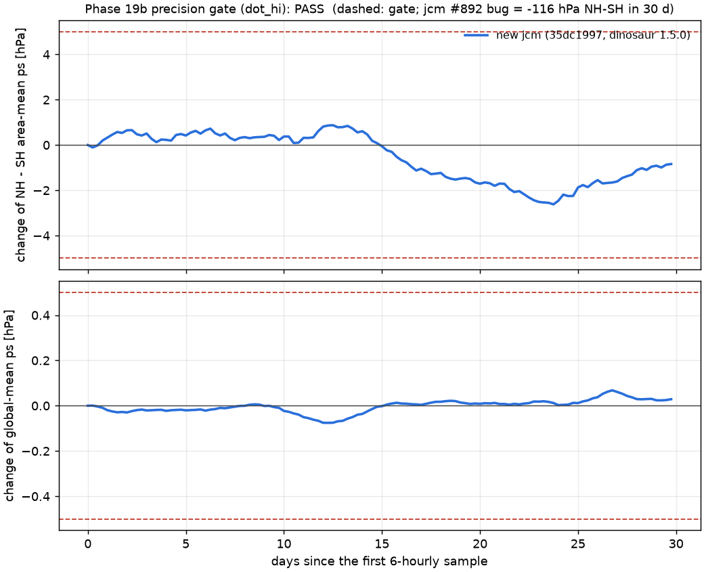

# Phase 19b precision gate: dot_hi

Run: `runs/p23s_dot_hi`

Gate: max |change of NH-SH area-mean ps| < 5.0 hPa and max |change of global-mean ps| < 0.5 hPa over the first 30 days (jcm #892: buggy -116 hPa NH-SH in 30 d, fixed +0.03 hPa on HS T63L47).

| run | NH-SH at start [hPa] | max abs dA | dA at end | global mean at start | max abs dG | dG at end |
|---|---|---|---|---|---|---|
| new jcm (35dc1997, dinosaur 1.5.0) | -3.77 | 2.621 | -0.840 | 998.56 | 0.0756 | +0.0287 |

**Result: PASS** (new jcm: max |dA| 2.621 hPa, end -0.840; max |dG| 0.0756 hPa, end +0.0287).

