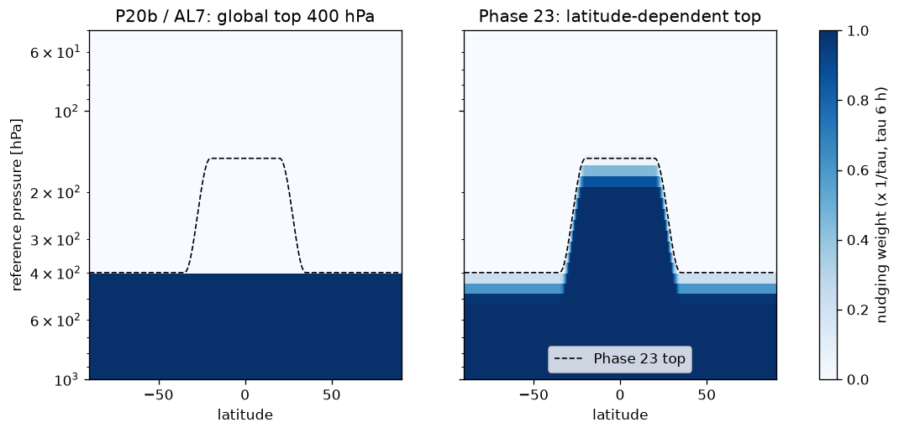
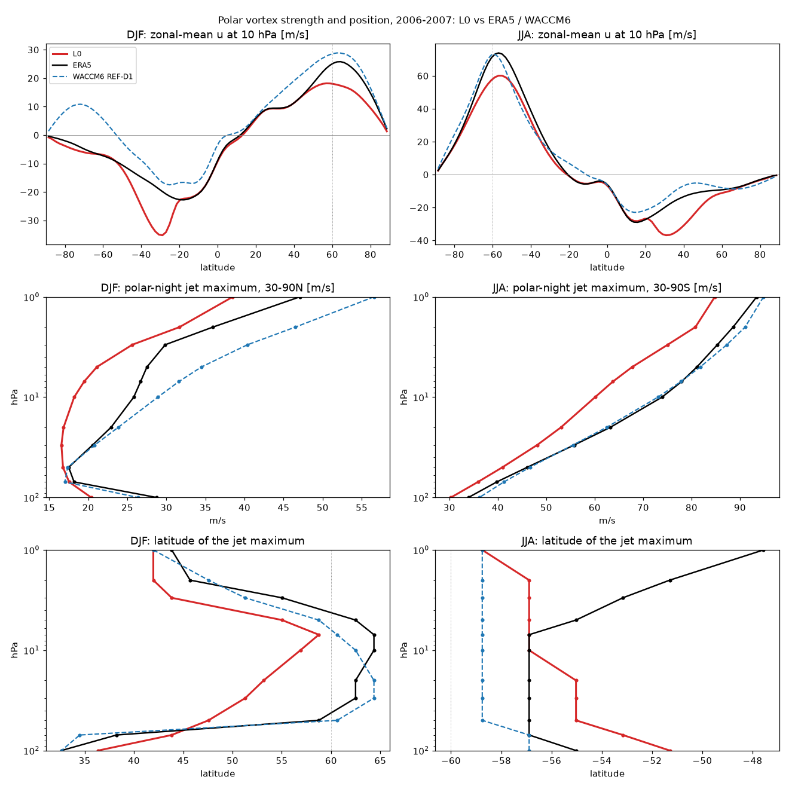
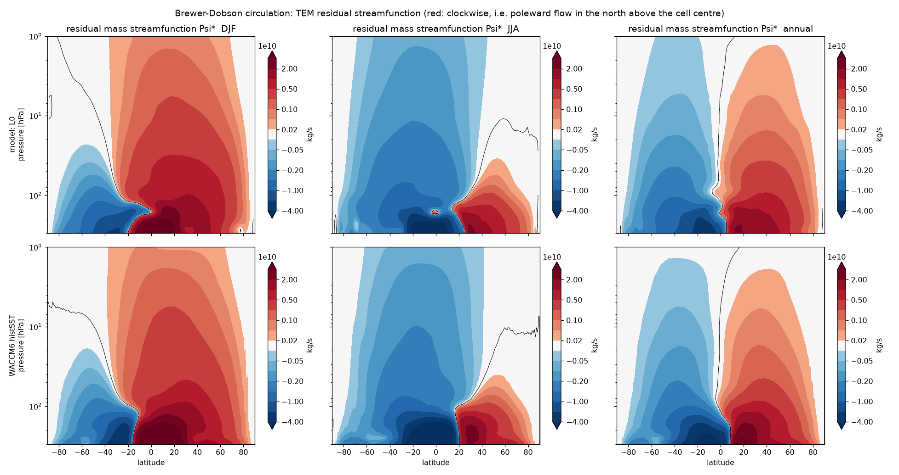

# Phase 23 — latitude-dependent top of the ERA5 nudging

**Goal (Susanne, 2026-10-20):** nudge only the troposphere. A single global nudging top cannot follow the tropopause: 150 hPa
nudges the extratropical lowermost stratosphere, and 400 hPa (13c, 19d, 20b, 22) stops nudging the tropical upper troposphere,
which in 13c and 21a removed the shallow branch of the Brewer-Dobson circulation. This phase puts the top at **150 hPa in the
tropics and 400 hPa in the extratropics**. Side question in the same phase: is dinosaur's faster bf16 dot algorithm usable?

## What changed

`jcm_strat/nudging_lat.py` (commit `cca7be8`): `LatTopNudgingTerm` is jcm's `NudgingTerm` with its u, v, T (and q) tendency
multiplied by a (level x column) weight. The top of the nudged region is 150 hPa for |lat| <= 20, 400 hPa for |lat| >= 35, with a
cos^2 blend in log p between, and the weight ramps from 0 at the top to 1 over 0.1 decade of log10 p below it (no hard step).
It is switched on by `nudging.lat_top` (absent = unchanged behaviour) and installed from `jcm_strat/main.py` by replacing
`jcm.nudging.with_nudging`; nothing in `external/jax-gcm` changes. Tests: `tests/test_nudging_lat.py` (3 passed). Tau (6 h),
`pbl_levels: 0`, temperature nudging and the ERA5 target are P20b's. Experiment `p23_lattop` (on `p22_teq`).

The only region where nudging changes is the tropical and subtropical 150-400 hPa layer (now nudged). Poleward of 35 deg the top
stays at 400 hPa; the taper weakens the nudging between 400 and ~540 hPa there.

## Runs

The 2 x 2 design (all four: dry 13d physics + fixed Lott-Miller, bottom levels nudged, L95 + cubic, QBO nudging on - tau 1 d,
90-1 hPa, |lat| < 25):

| run | T_eq correction | nudging top | compare with |
|---|---|---|---|
| P20b (`p20bt`) | none | 400 hPa everywhere | baseline |
| AL7 (`p22_AL7`, Phase 22) | AL7 (extratropics 400-1 hPa) | 400 hPa everywhere | Phase 22's best vortex |
| **L0** (`p23_L0`) | none | latitude-dependent | P20b: the nudging top is the only change |
| **LAL7** (`p23_LAL7`) | AL7 | latitude-dependent | AL7 |

Protocol as Phase 22: AL7, L0 and LAL7 restart from P20b's end-of-2004 state (1990-2004 are links to `p20bt`) and run 2005-2007.
`scripts/phase23_run.sh 0` (tmux `strat_p23_run`, GPU 0), 2026-10-20 16:26-18:14 PDT, 45 min per 3-year chain (~14 min per
simulated year), no health stops. Scores (`scores/`, `scripts/teq_score.py`) cover 2005-04..2007-12 against ERA5 for the same
months; the diagnostics (`scripts/phase23_diag.sh`, `phase23_diag2.sh`; `sweep/`, one folder per run) cover 2006-2007, on
aggregates holding only those two years (`runs/p23d_<run>_0607`).

## Results

### Winds and the vortex (scores, 2005-04..2007-12)

| | P20b | L0 | AL7 | LAL7 | ERA5 |
|---|---|---|---|---|---|
| u RMSE 100-10 hPa, abs(lat) >= 30 [m/s] | 7.80 | **5.88** | **3.84** | 4.76 | |
| u RMSE 10-1 hPa, extratropics [m/s] | 11.19 | 11.11 | 8.06 | 8.65 | |
| T RMSE 100-10 hPa [K] | 5.22 | 4.52 | 3.92 | **3.40** | |
| jet 50 hPa DJF north [m/s @ lat] | 15 @ 51 | 17 @ 48 | 19 @ 59 | 22 @ 59 | 17 @ 59 |
| jet 50 hPa JJA south | 39 @ 59 | 41 @ 53 | 47 @ 57 | 48 @ 55 | 47 @ 57 |
| jet 10 hPa JJA south | 58 @ 59 | 60 @ 55 | 76 @ 57 | 78 @ 55 | 76 @ 57 |

### Tropical upwelling (2006-2007, every 6-hourly frame)

| | P20b | L0 | AL7 | LAL7 | WACCM6 |
|---|---|---|---|---|---|
| w* 100 / 70 / 50 / 30 / 10 hPa [mm/s] | 0.13 / 0.20 / 0.28 / 0.32 / 0.38 | **0.17** / 0.20 / 0.30 / 0.34 / 0.43 | 0.16 / 0.24 / 0.31 / 0.31 / 0.40 | **0.18** / 0.25 / 0.33 / 0.32 / 0.42 | 0.40 / 0.21 / 0.20 / 0.26 / 0.47 |
| w* error vs WACCM6 (mean abs log ratio) | 0.40 | **0.34** | 0.37 | 0.35 | |
| upward mass flux 100 / 70 hPa, annual [10^9 kg/s] | 9.1 / 6.4 | 9.7 / 6.9 | 9.7 / 7.2 | 9.5 / 7.2 | 10.7 / 6.0 |
| DJF / JJA flux at 100 hPa | 11.6 / 7.8 | 13.1 / 8.5 | 12.0 / 7.7 | 12.5 / 8.7 | 14.0 / 9.4 |

### Age of air (2006-2007; clocks carry P20b's 1990-2004)

| | P20b | L0 | AL7 | LAL7 | reference |
|---|---|---|---|---|---|
| aoa150 at 55 hPa, tropics, DJF / JJA [yr] | 1.12 / 1.25 | 0.83 / 0.91 | 0.93 / 0.94 | 0.65 / 0.66 | WACCM6 1.03 / 1.07 |
| aoa150 at 55 hPa, 50-70N / 50-70S, JJA | 3.45 / 3.84 | 2.98 / 3.77 | 2.83 / 3.39 | 2.38 / 3.21 | 2.76 / 3.80 |
| aoa_sfc at 55 hPa, tropics, DJF / JJA | 2.60 / 2.73 | 2.18 / 2.21 | 2.15 / 2.14 | 1.86 / 1.79 | CLaMS 1.33 / 1.46 |
| aoa_sfc tropics 70 -> 10 hPa transit [yr] | 2.56 | 2.16 | 2.47 | 2.17 | CLaMS 3.01, WACCM6 2.51 |

### QBO and SAO

Unchanged. Deseasonalised equatorial u std at 10 / 20 / 30 / 50 hPa is 16.3 / 16.2-16.3 / 15.2-15.3 / 10.7 m/s in all four runs
(ERA5 16.8 / 17.1 / 16.0 / 11.1). The QBO window starts at 90 hPa, above the newly nudged layer. The SAO at 1 hPa is 21 (P20b),
18 (AL7), 30 (L0) and 25 (LAL7) m/s against ERA5's 37.

## Findings

1. **The latitude-dependent top partly restores the shallow branch.** w* at 100 hPa goes up by 32 % on P20b (0.13 -> 0.17 mm/s,
   100 hPa mass flux 9.1 -> 9.7 x 10^9 kg/s) and by 18 % on AL7 (0.16 -> 0.18; the annual 100 hPa flux there does not rise,
   9.7 -> 9.5), and L0's w* profile matches WACCM6 best of the four. It is still less than half of WACCM6's 0.40 at 100 hPa, so
   the 400 hPa cut was not the whole story.
2. **It improves the extratropical lower-stratospheric winds of P20b clearly (7.80 -> 5.88 m/s)** although nothing poleward of
   35 deg is nudged differently: the subtropical upper troposphere now follows ERA5, and with it the subtropical jet the
   planetary waves propagate through. On AL7 it does not help (3.84 -> 4.76 m/s; the NH 50 hPa jet becomes 5 m/s too strong).
3. **It does not fix the southern vortex.** The SH jet gains 1-3 m/s on either base and moves ~2 deg equatorward. AL7's T_eq
   correction remains what puts the vortex on ERA5 (50 hPa 47, 10 hPa 76 m/s).
4. **Tropical entry ages get younger** (aoa150 at 55 hPa: 1.12 -> 0.83 with L0; 0.93 -> 0.65 with LAL7, WACCM6 1.03). The
   surface clock gets younger too but stays far too old (2.2 vs CLaMS 1.3-1.5) - the dry troposphere's transit, as in Phase 12.
   LAL7 combines the two changes that each make the tropics younger and overshoots most.

## Side test: bf16 dot algorithm (speed)

`scripts/p23_dot_precision_test.{py,sh}`: 30 days of P20b from the end of 2004, jcm's `Precision.HIGHEST` override (current) vs
dinosaur's default `BF16_BF16_F32_X6`, GPU 0, 2026-10-20 18:16-18:20 PDT. Result: **the bf16 run went all-NaN in the first
10 days** (jcm health stop, `runs/p23s_dot_x6/log.txt`); HIGHEST was healthy (ps gate PASS, `dot_precision/dot_hi_ps_gate.md`).
Chunk time 21.0 s at HIGHEST vs 19.5 s for the (NaN) bf16 chunk, i.e. at most ~7 %. On jaxlib 0.10.2 the bf16 path is
miscompiled (jcm #892, dinosaur#147); it is not usable, and after a jax upgrade the gain is a few percent at best.
**Note:** `dot_precision/dot_x6_ps_gate.md` says PASS - that is wrong: the gate script read the NaN fields as zeros.

## Diagnostics notes

- `scripts/strat_circulation.py` reads every file of an aggregate whatever `--years` says: on the 18-year aggregates it ran for
  hours and, four at a time, was OOM-killed. Hence the 2006-2007-only aggregates. It also gained `--age-var` (default `aoa`, as
  before; the restart runs keep only `aoa150` and `aoa_sfc`, so all four use `aoa_sfc` here).
- The node rebooted on 2026-10-22 at 09:44 PDT during the first diagnostic pass; the run output was not affected.

## Decision

Open for Susanne. Candidates: keep the latitude-dependent top for the P20b line (better w* profile and lower-stratospheric winds,
younger tropical entry age); do not combine it with AL7 as it stands (overshoots the ages, worse winds than AL7 alone). The next
step for a tropopause-following top is issue #1 (ERA5 lapse-rate tropopause of the nudging target, ~1-2 days); not started.
